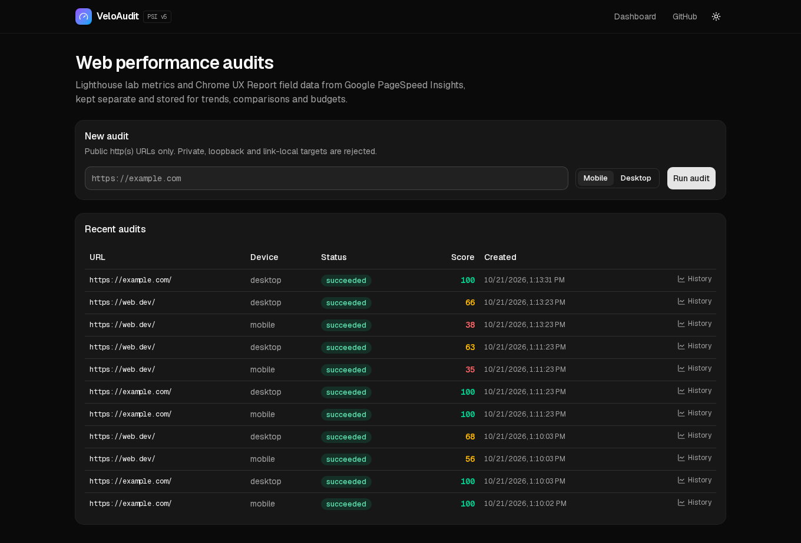
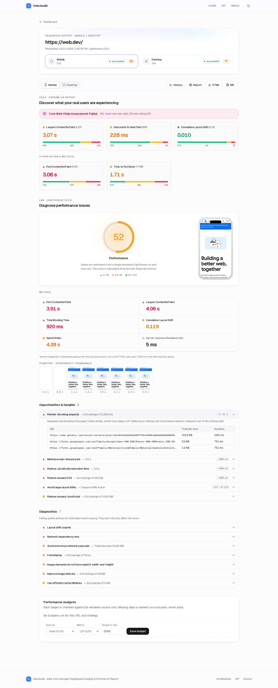
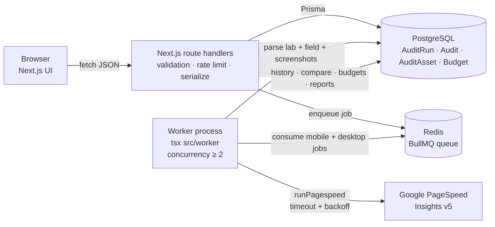
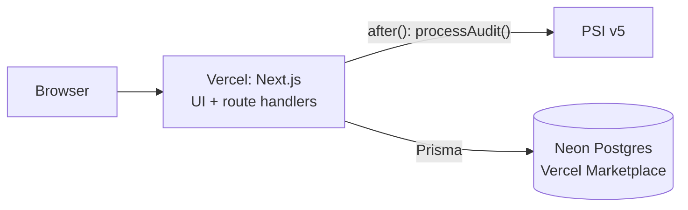

# VeloAudit

VeloAudit is a web performance auditor. Submit a public URL and VeloAudit audits mobile **and** desktop in parallel as one
linked run (or just one device). A background worker calls the Google PageSpeed Insights (PSI) v5 API and stores Lighthouse **lab** metrics and Chrome UX Report (CrUX) **field** metrics
as separate data sets. The UI lets you follow job status live, read the results and the opportunities Lighthouse found,
look at trends per URL, compare two runs, set performance budgets and download reports.

**Live demo:** https://veloaudit.vercel.app. This runs in **demo execution mode** (see [Execution modes](#execution-modes)):
Vercel functions with Neon Postgres (free plan, provisioned through the Vercel Marketplace). The demo shares one PSI quota and has no
durable queue, so treat it as a demo, not a production deployment.





## Engineering highlights

**Languages and tech:** TypeScript (`strict`, no `any`), SQL on PostgreSQL via Prisma (migrations, indexes, unique constraints),
Tailwind CSS v4 and shadcn/ui, React 19 with the Next.js 15 App Router, Zod, BullMQ on Redis, Recharts, next-themes,
Vitest, Playwright, GitHub Actions and Bash (CI scripts).

- **Layered separation.** HTTP routes only parse, guard and serialize. Validation, orchestration, the PSI client, parsing,
  recommendations, persistence, reporting and pure domain logic (`src/lib`: metrics, budgets, comparison) each live in their own module.
  The domain logic is shared by the server and the UI, so both evaluate budgets the same way.
- **Async work stays outside request lifetimes.** `POST /api/audits` writes a `QUEUED` row, enqueues a BullMQ job and returns 202.
  PSI is called only by a separate long-running worker process.
- **SSRF-conscious input validation.** Only http/https URLs are accepted. URLs with embedded credentials are rejected, as are localhost,
  private, link-local, CGNAT, multicast and documentation addresses, including IPv4-mapped IPv6. Hostnames are resolved and *every* returned address is checked.
- **Resilience.** The PSI client has per-attempt timeouts and exponential backoff with jitter for 429/5xx/timeouts. It fails fast on
  daily-quota 429s, 4xx responses and non-JSON bodies. Each job has a hard deadline that aborts in-flight requests, stuck jobs are
  recovered on worker start, and every audit ends in a terminal state with an error code.
- **Lab and field data are handled honestly.** Lab and field values are stored, charted, compared and budgeted separately. If field
  data is missing it shows as *Unavailable*. INP is never derived from TBT. A budget whose metric is missing is *not evaluable*, never
  *pass*. The lab "server response" value is labelled for what it is (backend latency), not presented as a full TTFB. Comparisons
  include a run-to-run variance caveat and a noise floor.
- **Safe API surface.** Errors are returned as `{ error: { code, message } }` with no stack traces. The API has per-IP rate limits,
  body size and content-type guards, and HTML-escaped reports served with a restrictive CSP. Logs are structured JSON and never contain the API key.
- **Test pyramid.** Pure unit tests cover validation, the parser, retry, budgets, comparison and reports. Integration tests run against
  real Postgres and Redis/BullMQ with a fake PSI transport. Playwright e2e tests cover UI flows, using `SYNTHETIC`-labelled seeded data
  where real data can't be used.
- **CI.** The GitHub Actions workflow runs the same `scripts/ci-steps.sh` that `npm run ci:local` runs from a clean copy, covering
  install, migrate, typecheck, lint, unit and integration tests, build and e2e.

## Architecture



See [ARCHITECTURE.md](ARCHITECTURE.md) for modules and the job lifecycle, and [docs/API.md](docs/API.md) for the full HTTP API.

## Execution modes

The same orchestration module (`src/server/orchestration/audits.ts`) is used in both modes: `enqueueRun()` creates the run and one `QUEUED`
audit per device, and `processAudit()` does the PSI call, parse and save, enforces the job deadline and always leaves a terminal status.
Only the executor changes.

| `AUDIT_EXECUTION_MODE` | Executor | Use for |
| --- | --- | --- |
| `queue` (default) | One BullMQ job per device on Redis, consumed in parallel (`WORKER_CONCURRENCY`, default 4) by the separate `npm run worker` process | **Production.** Retries and throughput are under your control, and the worker is decoupled from web requests. |
| `inline` | One `after()` task runs `processAudit()` for every device with `Promise.all`, scheduled with Next.js `after()` (Vercel `waitUntil`) in the `POST /api/audits` function (`maxDuration = 300`) | **Demo / serverless only.** Needs no Redis or worker host. The work still runs after the 202 response is sent, but it is bound to a function invocation: there is no durable queue, a crashed invocation loses its job (the row stays `RUNNING` until the deadline or stale recovery), and concurrency is unmanaged. |

### Live demo deployment (Vercel, inline mode)



- Database: Neon (free plan), connected to the Vercel project's production environment through the marketplace integration, which injects
  `DATABASE_URL` (pooled) and `DATABASE_URL_UNPOOLED`. Migrations use the unpooled URL.
- Other production env vars set on Vercel: `PSI_API_KEY` (sensitive), `DNS_RESOLVER=system`, `AUDIT_EXECUTION_MODE=inline` and
  `AUDIT_JOB_TIMEOUT_MS=240000`. `REDIS_URL` is not needed in inline mode.
- `vercel.json` runs `npm run vercel-build` (`prisma migrate deploy` against `DATABASE_URL_UNPOOLED` when set, then `next build`), so migrations are applied on each deploy.
- Rate limiting is in-memory per function instance, so on serverless it is only best-effort.

## Features

| Feature | Where |
| --- | --- |
| One submit audits mobile + desktop in parallel, with live per-device progress | `/` → `/runs/:id` |
| PSI-style results with a Mobile/Desktop tab switcher | `/runs/:id?tab=mobile\|desktop` |
| Core Web Vitals assessment (Passed/Failed, field data only) with good / needs-improvement / poor distribution bars from CrUX histograms | results page |
| Large threshold-colored score gauge and lab metric grid with ● / ■ / ▲ indicators (Lighthouse per-metric scores) | results page |
| Lighthouse final screenshot in a device frame, plus the `screenshot-thumbnails` filmstrip | results page |
| Expandable opportunity and diagnostic rows with the audit's own detail table | results page |
| History per URL and strategy, with separate lab and field trend charts | `/history?url=&strategy=` |
| Compare two completed runs (deltas, noise floor, variance caveat) | `/compare?a=&b=` |
| Performance budgets with an explicit lab or field source | audit and history pages, `/api/budgets` |
| Reports: printable HTML and Markdown | `/api/audits/:id/report?format=html\|md` |
| Light and dark mode | header toggle (defaults to the system setting) |

## Setup

Requirements: Node 20+, PostgreSQL 14+, Redis 6+.

```bash
cp .env.example .env          # edit as needed; never commit .env
npm ci
npx prisma migrate deploy
npm run build
npm start                     # web on :3000
npm run worker                # in a second terminal: BullMQ worker (separate process)
```

Development: `npm run dev` plus `npm run worker`.

## Environment variables

| Var | Required | Default | Notes |
| --- | --- | --- | --- |
| `DATABASE_URL` | yes | — | PostgreSQL connection string |
| `REDIS_URL` | yes | `redis://localhost:6379` | BullMQ connection |
| `PSI_API_KEY` | no | — | Recommended. Without it, keyless requests are tried, but Google's shared keyless quota is often exhausted (HTTP 429 "Queries per day"). Get a key at https://developers.google.com/speed/docs/insights/v5/get-started. Keep it in the environment or a secret manager, never in git. |
| `AUDIT_QUEUE_NAME` | no | `audits` | Use different names to isolate environments or tests |
| `AUDIT_EXECUTION_MODE` | no | `queue` | `queue` = BullMQ + worker (production). `inline` = run via `after()` in the request's function (demo/serverless). |
| `AUDIT_JOB_TIMEOUT_MS` | no | `300000` | Hard deadline per audit job |
| `WORKER_CONCURRENCY` | no | `4` | Worker job concurrency (min 2, so a run's mobile and desktop jobs execute in parallel) |
| `DNS_RESOLVER` | no | `system` | Set to `doh` (Google DNS-over-HTTPS) only where the system resolver returns synthetic IPs, such as some sandboxes or egress proxies |
| `TEST_DATABASE_URL` | tests | `…/veloaudit_test` | Database used by the integration tests |

`.env`, `.env.*` (except `.env.example`), key files, and test artifacts are gitignored.

## Tests

```bash
npm run test:unit         # pure logic; no services needed
npm run test:integration  # real Postgres (TEST_DATABASE_URL) + Redis (queue "audits-test")
npm test                  # both
npm run test:e2e          # Playwright against a running app + worker (BASE_URL, default :3000)
E2E_REAL_PSI=1 npm run test:e2e   # also runs a live web.dev audit (uses PSI quota)
npm run ci:local          # simulates the GitHub Actions job without Docker/act
```

Fixtures are labelled. `tests/fixtures/psi-synthetic.ts` contains invented values. `psi-real-webdev-mobile-excerpt.json` is a
trimmed real PSI response. The e2e history and compare tests seed rows with a `.invalid` URL and `lighthouseVersion: "SYNTHETIC"`, and delete them afterwards.

## Deployment architecture

The worker needs a **long-running host**. Do not run it on serverless functions: audits take 10–60 s or longer, need retries and
backoff, and hold a BullMQ lock.

- **Web:** Next.js (`npm run build && npm start`) on any Node host or container platform. It is stateless and can be scaled
  horizontally once the rate limiter moves to Redis (see limitations). The web tier could also run on a serverless Next.js host,
  because it only enqueues jobs.
- **Worker:** one or more always-on containers or VMs running `npm run worker` (for example a container service, a VM with
  systemd, or a Kubernetes Deployment). Scale by replica count and the `concurrency` setting. Handle `SIGTERM` for graceful shutdown (already implemented).
- **PostgreSQL:** a managed instance. Run `prisma migrate deploy` as a release step.
- **Redis:** a managed instance with persistence (AOF) enabled so queued jobs survive restarts.
- **Secrets:** `PSI_API_KEY` and the database and Redis URLs come from the platform's secret store.

## Known limitations

- The public demo uses inline mode on a free Neon plan (see Execution modes). It is not a production deployment.
- The rate limiter is in-memory per process, so it is only correct for a single web instance.
- The DNS validation is a policy guard. PSI fetches the page from Google's network, and DNS rebinding between our check and Google's fetch is not mitigated.
- Lab results come from a single Lighthouse run per audit, with no median-of-N. Field data is a CrUX 28-day aggregate and only appears when Google has enough traffic data.
- There are no authentication or multi-tenant budgets. Budgets are global per URL and strategy.
- Raw PSI JSON is not stored, so new metrics can't be backfilled from old audits. Audits from before runs existed have no
  distributions, screenshots or diagnostics and open as a single-device view.
- Per-device progress is real state (queued / running / done + elapsed time). PSI exposes no percentage, so none is shown.
- Screenshots are what Lighthouse captured in Google's lab environment (stored in Postgres as small JPEGs, roughly 20-40 KB per run), not a live view of the site.
- Only URL-level-or-fallback CrUX data from `loadingExperience` is shown. PSI's separate "origin" toggle is not reproduced.
- The "printable" report relies on the browser's Print → PDF. No server-side PDF is generated.

## Future work

- Median-of-N lab runs, with confidence ranges on the comparison page.
- Scheduled and recurring audits, with alerts when budgets fail.
- A Redis-backed rate limiter, auth, and per-user or per-project budgets.
- Store raw PSI responses in object storage for reprocessing.
- CrUX History API trends for longer field data history.
- OpenTelemetry traces and metrics for the worker.
